<h1 align="center">Hello Fellow &lt; Coders/ &gt;! Hi, I'm Harsha Lekamge </h1>

  

 

## ⚡ `whoami`

  <picture>
    <source media="(prefers-color-scheme: dark)" srcset="./assets/whoami-dark.svg" />
    <source media="(prefers-color-scheme: light)" srcset="./assets/whoami-light.svg" />
    
  </picture>

 

  <picture>
    <source media="(prefers-color-scheme: dark)" srcset="./assets/stack-dark.svg" />
    <source media="(prefers-color-scheme: light)" srcset="./assets/stack-light.svg" />
    
  </picture>

 

## 🛠️ Toolbox 

<table align="center">
  <tr>
    <td align="center" width="200">
      
    </td>
    <td>
      <b>Languages</b> 
        
      <b>Frontend</b> 
        
      <b>Backend &amp; Data</b> 
        
      <b>AI &amp; Vision</b> 
        
      <b>Tools &amp; Cloud</b> 
      
    </td>
  </tr>
</table>
