<p align="center">
  <picture>
    <source media="(prefers-color-scheme: dark)" srcset="./assets/profile-2026-11-26-d3843e-dark.svg" />
    <source media="(prefers-color-scheme: light)" srcset="./assets/profile-2026-11-26-d3843e-light.svg" />
    
  </picture>
</p>

<p align="center">
  <a href="https://portfolio.harshalekamge.com/">
    <picture>
      <source media="(prefers-color-scheme: dark)" srcset="./assets/footer-2026-11-26-d3843e-dark.svg" />
      <source media="(prefers-color-scheme: light)" srcset="./assets/footer-2026-11-26-d3843e-light.svg" />
      
    </picture>
  </a>
</p>

<table width="100%">
<tr>
<td width="50%">


**01 / WhatsApp &amp; Phone**
```text
+94 77 875 3792
```

**03 / Email**
```text
lekamge.h2024@gmail.com
```

</td>
<td width="50%">


**02 / Email**
```text
harshalekamge.official@gmail.com
```

**04 / Portfolio**
```text
https://portfolio.harshalekamge.com/
```

</td>
</tr>
</table>

<table width="100%">
<tr>
<td valign="top" width="34%">

**[Harsha Lekamge](https://portfolio.harshalekamge.com/)**

Software engineer and Data Science undergraduate at SLIIT — building software that ships.

[GitHub](https://github.com/harshalekamge) · [WhatsApp](https://wa.me/94778753792) · [Email](mailto:harshalekamge.official@gmail.com) · [Portfolio](https://portfolio.harshalekamge.com/)

</td>
<td valign="top">

**Work**

[Smart Campus](https://github.com/harshalekamge/it3030-paf-2026-smart-campus-group183)<br>
[Kola Vision](https://github.com/harshalekamge/kola-vision)<br>
[GreenCycle.lk](https://github.com/harshalekamge/GreenCycle.lk)<br>
[File Tracking](https://portfolio.harshalekamge.com/)

</td>
<td valign="top">

**Skills**

[Web Apps](https://github.com/harshalekamge?tab=repositories&language=javascript)<br>
[AI &amp; Vision](https://github.com/harshalekamge/kola-vision)<br>
[Data Science](https://github.com/harshalekamge?tab=repositories&language=python)<br>
[UI Design](https://portfolio.harshalekamge.com/)

</td>
<td valign="top">

**Connect**

[Portfolio](https://portfolio.harshalekamge.com/)<br>
[WhatsApp](https://wa.me/94778753792)<br>
[Email](mailto:harshalekamge.official@gmail.com)<br>
[GitHub](https://github.com/harshalekamge)

</td>
<td valign="top">

**Studying**

[SLIIT](https://www.sliit.lk/)<br>
BSc (Hons) IT<br>
Data Science

</td>
</tr>
</table>

<p align="center">© 2026 Harsha Lekamge.</p>

<p align="center">
  <picture>
    <source media="(prefers-color-scheme: dark)" srcset="./assets/bottom-2026-11-26-d3843e-dark.svg" />
    <source media="(prefers-color-scheme: light)" srcset="./assets/bottom-2026-11-26-d3843e-light.svg" />
    
  </picture>
</p>
