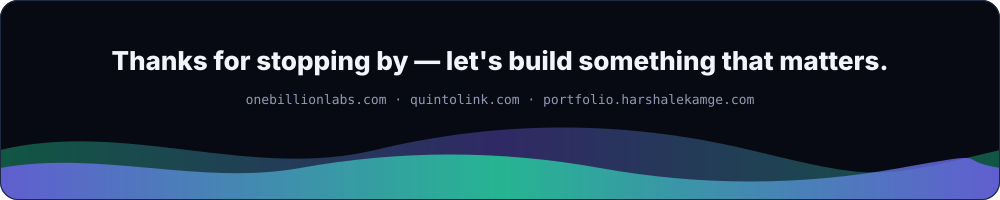

  

<h1 align="center">Hello Fellow &lt; Coders/ &gt;! Hi, I'm Harsha Lekamge </h1>

  

  
  
  
  
  

 

## ⚡ `whoami`

  
  

- 🏢 Founder & CEO of **[One Billion Labs](https://www.onebillionlabs.com)** and co-founder of **[Quintolink](https://quintolink.com)** — building websites, web apps and custom software for businesses in Sri Lanka.
- 🧠 Researching **Kola**, a vision AI that understands what's on screen (YOLO11 + OCR) and navigates it by voice, so people with motor or visual impairments can use apps like YouTube hands-free.
- 🏛️ Built internal systems at the **Department of the Registrar of Companies** as an Intern Software Engineer — file tracking, a centralized comment hub and an IT asset inventory.
- 🌱 Currently levelling up in **Next.js, Spring Boot, computer vision and AI agents**.
- 📫 Reach me at **lekamge.h2024@gmail.com**

 

## 🚀 Things I've shipped

  
  
  
  
  
  

 

## 🧭 The journey so far

  

 

## 🛠️ Toolbox 

<table align="center">
  <tr>
    <td align="center" width="200">
      
    </td>
    <td>
      <b>Languages</b> 
        
      <b>Frontend</b> 
        
      <b>Backend &amp; Data</b> 
        
      <b>AI &amp; Vision</b> 
        
      <b>Tools &amp; Cloud</b> 
      
    </td>
  </tr>
</table>

 

## 📈 GitHub in numbers

<b>Stats, languages &amp; streak</b>

 

  

  

  

  <picture>
    <source media="(prefers-color-scheme: dark)" srcset="https://raw.githubusercontent.com/harshalekamge/harshalekamge/output/github-contribution-grid-snake-dark.svg" />
    
  </picture>

 

  

