<p align="center">
  <picture>
    <source media="(prefers-color-scheme: dark)" srcset="./assets/profile-2026-11-27-cd208b-dark.svg" />
    <source media="(prefers-color-scheme: light)" srcset="./assets/profile-2026-11-27-cd208b-light.svg" />
    
  </picture>
</p>

<p align="center">
  <a href="https://portfolio-kappa-azure-bhhoh68iit.vercel.app/">
    <picture>
      <source media="(prefers-color-scheme: dark)" srcset="./assets/footer-2026-11-27-cd208b-dark.svg" />
      <source media="(prefers-color-scheme: light)" srcset="./assets/footer-2026-11-27-cd208b-light.svg" />
      
    </picture>
  </a>
</p>

<table width="100%">
<tr>
<td width="50%">


**01 / WhatsApp &amp; Phone**
```text
+94 77 875 3792
```

**03 / Email**
```text
lekamge.h2024@gmail.com
```

</td>
<td width="50%">


**02 / Email**
```text
harshalekamge.official@gmail.com
```

**04 / Portfolio**
```text
https://portfolio.harshalekamge.com/
```

</td>
</tr>
</table>

<p align="center">
  <picture>
    <source media="(prefers-color-scheme: dark)" srcset="./assets/bottom-2026-11-27-cd208b-dark.svg" />
    <source media="(prefers-color-scheme: light)" srcset="./assets/bottom-2026-11-27-cd208b-light.svg" />
    
  </picture>
</p>
