<h1 align="center">Hello Fellow &lt; Coders/ &gt;! Hi, I'm Harsha Lekamge </h1>

  

 

## ⚡ `whoami`

  <picture>
    <source media="(prefers-color-scheme: dark)" srcset="./assets/whoami-dark.svg" />
    <source media="(prefers-color-scheme: light)" srcset="./assets/whoami-light.svg" />
    
  </picture>

 

  <picture>
    <source media="(prefers-color-scheme: dark)" srcset="./assets/framed-dark.svg" />
    <source media="(prefers-color-scheme: light)" srcset="./assets/framed-light.svg" />
    
  </picture>

